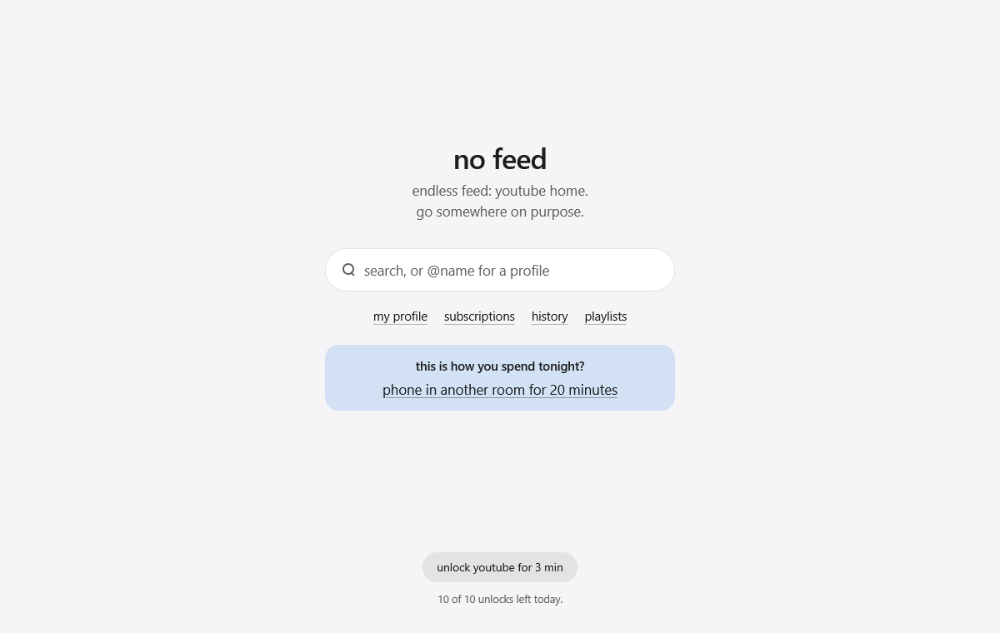

<p align="center">
  
</p>

<h1 align="center">dis2tract</h1>

<p align="center">
  <b>the feed ends here. everything else stays.</b><br>
  a firefox extension for desktop and android that blocks endless feeds, not whole sites.
</p>

<p align="center">
  youtube · x · tiktok · instagram · reddit · facebook · threads · bluesky · linkedin
</p>

<p align="center">
  
</p>

most blockers shut the whole site. then you need one video, one profile or one message, and the blocker gets removed. dis2tract blocks only the part built to keep you scrolling.

## what it does

- **feeds are gone**: home, for you, explore, shorts and reels tabs show a block screen with search, `@name` for a profile, and links to your profile and messages.
- **everything else stays**: what you search for, profiles and messages have no limit; hashtag pages and a site's suggested searches keep the scroll limit. single posts and other pages work until the 5th post in a row or 12 screens of scrolling.
- **porn sites are gone for good**: sites on oisd's nsfw list never load, also as a player inside another page, behind a redirect or through google translate, and a post or profile you open on x, reddit or bluesky that the site itself marks adult goes the same way. a roast shows instead. no unlock. not covered: sites the list doesn't know, pictures inside other pages (image search: turn safesearch on), other proxies and platforms.
- **one question, one task**: every block screen asks why you're here and gives one thing to do instead, linked straight to it. after 30 minutes on these sites in a day, it shows that time and what it was enough for instead (below).
- **the time adds up**: time on these sites counts per day, only while you use a page and never on the block screen. past 30 minutes, the block screen says how much, and one thing it was enough for: a 12 km run and its calories, 72 pages of a novel, a real dinner.
- **unlocking is slow on purpose**: a 15-second pause, then a challenge with no pasting. 3 minutes of feed per unlock, counted only while you watch or scroll, with the time left at the top. 20 minutes apart, 10 a day, none at bedtime (23:00 to 5:00; settings can make it longer, never shorter).
- **nothing about you leaves the browser**: no servers, no analytics. its one download is the porn list, once a day; firefox also checks github for a new version once or twice a day.

[how it works in detail →](docs/how-it-works.md)

## install

download the `.xpi` from the [latest release](https://github.com/purr/dis2tract/releases/latest) and open it in firefox; after that it updates itself. android, private windows and making it hard to uninstall: [install guide →](docs/install.md)

## develop

```sh
npm ci && npm test && npm run lint
```

every push to main and every pull request builds and tests on github; raising the version in `manifest.json` signs and releases it. [development →](docs/development.md) · [changelog →](CHANGELOG.md)

<p align="center"><sub>close the feed. keep the internet.</sub></p>
