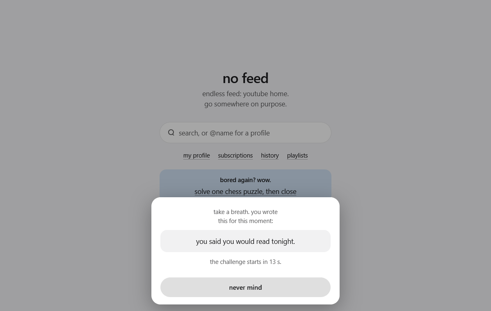
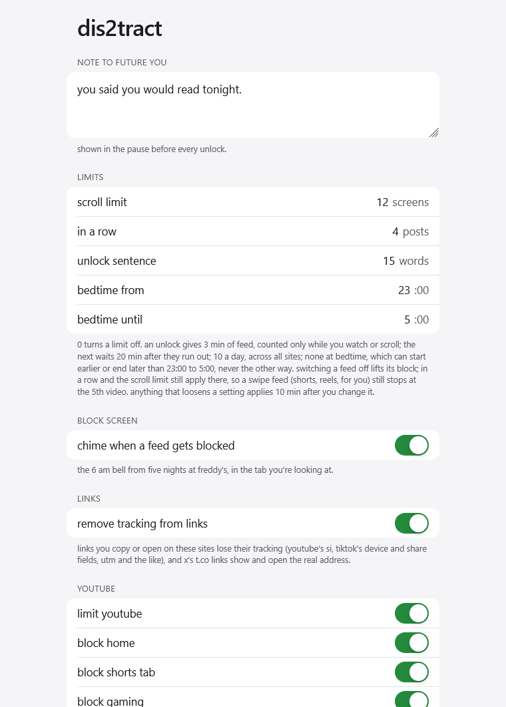

# how it works

## what happens where

| you open | you get |
| --- | --- |
| a feed | the block screen: search, `@name` for a profile, links to your profile, messages and notifications, and one question with something better to do. opened from scratch, the site stops loading at once, so none of it runs behind the block. logged out, the front page of instagram, facebook and linkedin is their log-in form, blocked as the home feed, so their block screen links "log in" |
| search results you typed, a profile, messages | allowed, with no scroll limit: you opened them on purpose. hashtag pages and searches the site opens from a link (x's trends, hashtags and cashtags, threads' tags) are the site's pick, so they keep the scroll limit, and so does bluesky's explore page |
| any other page | allowed, until you scroll 12 screens deep. then "keep scrolling" gives that page 12 more screens after a 10-second wait, as often as you like |
| a single video or post | allowed. 4 different ones in a row are fine, the 5th is blocked. back steps out again; a profile or a search starts a new count |
| a site on the nsfw list | never loads: a page roasts you instead, with a meme clip, and says what set it off. no unlock, no switch |

## porn sites

blocked for good: the tab goes to the roast page before the site shows, and the page says which address set it off. that includes a page that embeds a listed site once its player loads (a porn player inside a reddit post), a link that redirects to one (a short link, a mirror domain) and a listed site opened through google translate. tabs already open are checked when firefox starts and whenever the list changes. which sites count comes from [oisd's nsfw small list](https://oisd.nl): the nsfw sites among the top million domains, each with its subdomains: porn, adult, shock and gore alike, not told apart. a few entries that aren't nsfw sites are skipped: two chinese web fiction sites, sofia's public transport, two hosting tools' preview addresses, and public suffixes such as co.cz, which would block every site under them. dis2tract downloads the list once a day from github and keeps the last copy for offline starts; the adult top-level domains (.xxx, .porn, .sex, .adult) are blocked even before the first download. a site the list doesn't know isn't blocked. going back from the roast page never lands on the page that set it off.

x, reddit and bluesky allow porn among everything else, so their porn is caught by what they say about it themselves: x marks adult pictures and videos as adult content (apart from violence), reddit tags posts and adult communities nsfw (one tag for sex and gore alike, so war footage and injuries count too), bluesky labels posts and accounts porn, sexual or suggestive drawing (not non-sexual nudity). only what you opened counts: a post, a profile with its own posts, or an adult subreddit's pages. search, home, notifications, lists, and a stranger's marked reply or follower don't. the marked post never shows: the tab goes to the roast page instead. there's no word list, so slang and other languages are caught too. firefox only runs dis2tract in private windows if you allow it ([install guide](install.md)).

## blocked feeds

every feed can be switched off on its own in settings, for example to allow tiktok live. switching a feed off lifts its block; in a row and the scroll limit still apply there, so a swipe feed (shorts, reels, for you) still stops at the 5th video in a row.

| site | blocked | still open |
| --- | --- | --- |
| youtube | home (trending and /index too), shorts tab, and the explore pages gaming, podcasts, live, music, news, sports and learning, also at their channel addresses | search, channels, videos, subscriptions, history, playlists |
| x | home timeline, explore, communities (your communities' timeline and its explore tab) | search, profiles, posts, single communities, notifications, messages, bookmarks |
| tiktok | for you (under every language address too: /zh-Hans, /es-419, /fil-PH), following, friends, explore, live with its following, gaming and lifestyle tabs | search, profiles, videos, messages |
| instagram | home, explore, reels tab | search, profiles, posts, single reels, stories, messages, notifications |
| reddit | front page and its sort tabs, r/popular, r/all, news, topic pages (/t/…) | subreddits, posts, search, profiles, messages |
| facebook | home, video tab (/video, /videos and its live tab too), reels tab, groups feed, also on the language addresses (de-de.facebook.com) | profiles, posts, single groups, messages, notifications |
| threads | for you (/for_you and the logged-out /global too), following, custom feeds | search, profiles, posts, activity |
| bluesky | home, custom feeds, explore | search, profiles, posts, notifications, messages |
| linkedin | home feed, with its for you and network tabs | search, profiles, posts, messages, notifications, jobs |

a youtube playlist counts as one video in a row; a mix counts every video, since it autoplays forever. x's full-screen video viewer on a phone counts every video you swipe to. facebook stories count once per person, like instagram's; group posts opened by their link and youtube clips count too.

## no easy way out

- a reload or a new tab within a minute keeps your place in the count and on the scroll limit. a link followed from another site (search results) starts a new count.
- the scroll limit counts screens, so rotating the phone or resizing the window doesn't lift a block.
- in a private window nothing is stored: the count in a row lives in memory until firefox closes. unlocks, their waits and the day's time are shared with normal windows, so a private window is no way around them.
- a video opened from a feed within 3 seconds still counts as the feed. instagram's reels tab and youtube's shorts tab jump straight into a random video.
- players behind the block screen pause, fullscreen closes, and the page can't pull the cursor out of the block screen.

## the mirror and the roast

jump from one feed to another within 10 minutes and the top of the block screen says so:

> tiktok 1 min ago, now youtube. same urge, new app.

every block screen asks one question, picked at random, and answers it with one thing to do right now. a link goes straight to the thing (a running timer, a follow-along workout, a chess puzzle), never to a search page, which is just another feed.

| question | for example |
| --- | --- |
| bored again? wow. | solve one chess puzzle, then close |
| your thumb works out more than you. | 7-minute workout, follow along |
| avoiding something again? classic. | work on it until this timer ends |
| this is how you spend tonight? | three monkeytype tests, beat your best |

once today holds more than 30 minutes on these sites (the daily cap that eased loneliness and depression in [a 2018 study](https://guilfordjournals.com/doi/10.1521/jscp.2018.37.10.751)), the question is that time, answered with one random thing it was enough for:

> 1 h 12 min on social media today. enough to run 12 km, ~780 kcal

the others: a walk, a bike ride or a swim with their calories, workouts, pages of a novel, language lessons, meditations, calls with friends, a letter, real dinners, a clean home, yoga, sleep. calories are for a 70 kg adult. time counts while a page of these sites is on screen and you scrolled, tapped or typed in the last 10 seconds, or a video plays (a muted one only within a minute of your last input: feeds loop muted clips by themselves). it never counts while the block screen is up or in a background tab, and starts from zero at midnight.

from 23:00 to 5:00 there is only one: *still up, scrolling? phone away, lights off. now.*

## unlocking

  

sometimes you do want the feed. you can unlock it, but slowly, on purpose:

1. **a 15-second pause** shows the note you wrote to yourself, with a "never mind" button. in a field study, the option to back off changed behaviour more than the delay itself (one sec, pnas 2023).
2. **a random challenge**, one of:
   - retype a line of random words (15 by default)
   - type a line of words backwards, last word first
   - work out something like `37 × 6 + 52` in your head
   - count one letter in a line of words

   only typing counts, one character at a time. pastes, drops, keyboard clipboard chips, dictation and swipe typing are undone, and text that another extension slips in (one that re-enables right click and paste) is thrown away on enter.
3. **a wrong enter costs 30 seconds**: the sheet says it was wrong (math and counting show the right number), waits, then brings a new challenge. closing and reopening the sheet doesn't skip the wait. a typing challenge opens by itself the moment the text is right, so enter on a typo counts as wrong. full-width digits (chinese, japanese) and arabic or persian digits count as numbers, and page translation leaves the text to type alone.

escape closes the sheet. once unlocked, a pill at the top shows the time left; in the last 30 seconds it counts down in red. under the unlock button, the block screen says how many unlocks are left today.

| rule | value |
| --- | --- |
| one unlock | 3 min of feed on that site. they run only while a page the unlock lets through is on screen and in use: you scrolled, tapped or typed in the last 10 s, or a video plays (a muted one only within a minute of that). pause the video or leave with time left and it waits for you until the next unlock could start (23 min after unlocking), or until you take an unlock elsewhere |
| between unlocks | 20 min after the time runs out (or would have, used in one go), across all sites |
| per day | 10, across all sites |
| bedtime | from 23:00 to 5:00 no unlock starts, and one still running ends then. a wait that would end inside bedtime ends with it. settings can start it earlier or end it later |
| one more minute | offered once, for 2 min after the time runs out. the next unlock then waits 30 min from when you took it |

these rules have no setting on purpose: a setting would be the way around them. they live in `UNLOCK` in `src/settings.js`. bedtime is the one exception, because settings can only make it longer.

## settings

  

open them with the dis2tract toolbar button, or about:addons → dis2tract → preferences. on android: firefox menu (⋮) → extensions → dis2tract.

- **note to future you**: shown in the pause before every unlock.
- **limits**: scroll limit (12 screens), in a row (4 posts), unlock sentence (15 words, at least 12). 0 turns a limit off. bedtime starts between 18:00 and 23:00 and ends between 5:00 and 15:00.
- **private windows**: when firefox doesn't run dis2tract in private windows, the page says so and where to allow it.
- **per site**: limit the site at all, each feed on its own, extras like youtube theater mode, and your handle where the site has no own-profile url (tiktok, x, instagram, threads, bluesky).
- **loosening waits**: switching a site or feed off, raising a limit, shortening the sentence or bedtime applies 10 minutes later, with a cancel button meanwhile, and the status line says when. tightening applies at once.
- **stats**: unlocks, wrong answers and app hops so far, with the date the count started.

## also

- **a chime**: a block that appears while you browse fades in with the 6 am bell from five nights at freddy's, in the tab you're looking at, unless that tab is muted. settings → block screen switches it off. firefox for android lets one tab play sound at a time, so the bell would stop your music there: no bell on android.
- **your theme's colors**: the block screen, the porn page and settings follow your firefox theme, live, from the first frame, wherever its colors stay readable (a pair that doesn't keeps the default palette). desktop only: firefox for android has no themes.
- **clean links**: a link copied on these sites, with the site's own copy or share button, firefox's copy link or as selected text, and a link you open there, lose their tracking parameters: youtube's `si`, x's `a`, `s` and `t`, tiktok's device and share fields, instagram's `igsh`, reddit's `share_id`, facebook's `mibextid`, threads' `xmt`, linkedin's `rcm` and `trk`, and `utm_`, `fbclid`, `gclid` and the like anywhere (the lists follow clearurls). what a link opens stays: youtube's video, time and playlist, reddit's context. x's `t.co` links show, open and copy the real address, link cards too. a link x loads outside its api keeps `t.co` until you point at it, and then only if its text holds the address. the address bar is left as the site keeps it. settings → links switches it off.
- **theater mode**: youtube opens every video in theater mode, which moves the recommendations below the video. switchable per site. its cookie lasts the browser session, like youtube's own; switching theater mode or youtube off removes it on the next youtube page.
- **uninstall**: removing dis2tract on desktop opens npr's piece on the inventor of infinite scroll, who now wants to kill it. firefox for android opens nothing. nothing about you is sent along.
- **privacy**: no servers, no analytics. its one request is the porn list, once a day, from github, with no cookies and no id of your browser. firefox itself checks github for a new version once or twice a day, without cookies; before 0.8.0 it sent that check to addons.mozilla.org, with the firefox version, os and language in the address. everything else stays in `browser.storage.local`.

## known limits

- every time rule trusts the system clock. setting it back stretches an unlock, setting it forward skips a cooldown.
- mobile youtube has no theater mode.
- without the [uninstall policy](install.md#make-it-hard-to-uninstall-desktop-optional), anyone can still remove the extension. it is a speed bump, not a lock.
- porn that isn't a site on the list gets through: pictures and videos shown inside other pages (brave images and yandex show adult pictures on their default setting, google blurs them, and every search engine shows them with safesearch off), a listed site's media opened at its own address, proxies other than google translate (startpage's anonymous view), and other platforms (discord, telegram, tumblr, mastodon, pixiv, lemmy). a [family dns filter](install.md#block-more-porn-optional) covers more of it.
- a page that loads while firefox starts shows until dis2tract checks the open tabs, a moment later.
